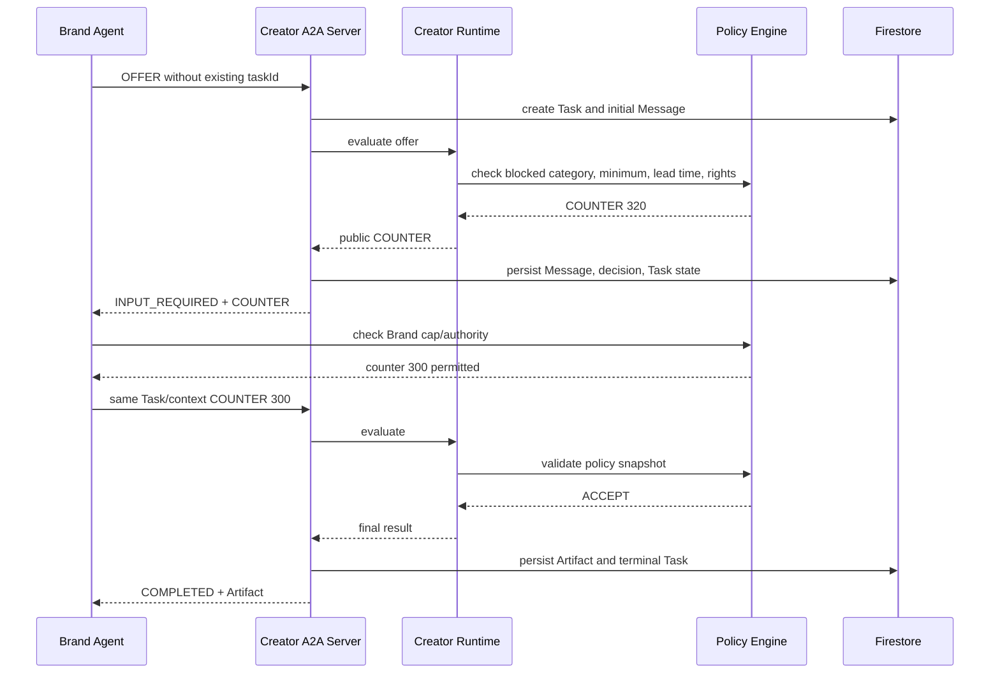

# A2A Negotiation Protocol

## 1. Scope

A2A handles communication with the selected Creator Agent:

- AgentCard and capability/interface discovery;
- Message transport;
- Task creation and state;
- multi-turn negotiation;
- streaming/subscription where supported;
- final Artifact.

A2A does not perform:

- creator database search;
- ranking;
- private policy calculation;
- Agreement persistence semantics;
- escrow or settlement.

Those are KNOT application responsibilities.

## 2. Roles

For sponsorship negotiation:

```text
Brand Agent   = A2A Client
Creator Agent = A2A Server / remote agent
```

The Creator owner does not need an open browser.

## 3. Agent Registry and AgentCard

After a candidate is selected, Brand Agent retrieves the registered AgentCard and validates:

- Agent identity/version;
- supported interface URL;
- protocol binding/version;
- tenant/routing identifier when declared;
- authentication requirements;
- `sponsorship-negotiation` skill;
- input/output media types;
- streaming capability.

Private negotiation policy is not in AgentCard.

Representative structure:

```json
{
  "name": "KNOT Creator Negotiation Agent",
  "description": "Evaluates and negotiates creator sponsorship offers.",
  "supportedInterfaces": [
    {
      "url": "https://service.example/a2a/v1",
      "protocolBinding": "HTTP+JSON",
      "protocolVersion": "1.0",
      "tenant": "creator-agent-001"
    }
  ],
  "version": "1.0.0",
  "capabilities": {
    "streaming": true,
    "pushNotifications": false
  },
  "skills": [
    {
      "id": "sponsorship-negotiation",
      "name": "Sponsorship Negotiation",
      "inputModes": ["application/json"],
      "outputModes": ["application/json"]
    }
  ]
}
```

Codex must verify the installed official A2A package/schema rather than inventing fields if the dependency differs.

## 4. Domain payload

KNOT domain schema:

```text
knot.negotiation.v1
```

Domain message types:

```text
OFFER
COUNTER
ACCEPT
REJECT
ESCALATE
```

These are inside `Part.data`; they are not replacements for A2A protocol enums.

Example:

```json
{
  "mediaType": "application/json",
  "data": {
    "schema": "knot.negotiation.v1",
    "type": "OFFER",
    "round": 1,
    "terms": {
      "baseAmountUsdc": 250,
      "deliverables": [{"format": "REEL", "count": 1}],
      "usageRights": "ORGANIC_ONLY",
      "deadline": "2026-08-10T14:59:59Z"
    },
    "publicRationale": "릴스 1개 조건으로 시작해볼게요."
  }
}
```

Never include Brand hard maximum or Creator exact minimum in public payloads.

## 5. Context and Task mapping

```text
Match Run
├─ candidate 1 Negotiation
│  └─ one A2A negotiation Task, multiple rounds
├─ candidate 2 Negotiation
│  └─ one A2A negotiation Task, multiple rounds
└─ first Agreement stops run
```

```text
contextId = one Brand–Creator transaction context
taskId    = negotiation Task inside that context
```

The server creates a new Task ID for the initial request if required by the binding. Follow-up messages use the same Task/context pair.

## 6. Task states

Use official installed enum values. Product mapping expected by current architecture:

| A2A state | KNOT meaning |
|---|---|
| Submitted | initial offer accepted for processing |
| Working | Agent runtime generating/validating response |
| Input required | counteroffer sent; waiting for Brand Agent response |
| Auth required | additional authority or explicit permitted action required |
| Completed | final Artifact generated |
| Rejected | server refuses Task itself |
| Failed | infrastructure/processing failure |
| Canceled | Task canceled |

A business rejection after valid processing should normally be represented as a completed result Artifact with `result=REJECTED`, preserving the distinction between protocol failure and valid negative outcome.

## 7. Multi-turn sequence



## 8. Decision split

Gemini may produce:

- proposed public rationale;
- proposed counter amount within an allowed band;
- structured extraction of terms;
- negotiation tone.

Deterministic code decides:

- blocked category;
- minimum/maximum bounds;
- lead time;
- rights compatibility;
- maximum rounds;
- authority/escalation;
- whether payment can execute.

Model output is schema-validated and rechecked.

## 9. Final Artifact

Agreed:

```json
{
  "schema": "knot.term-sheet.v1",
  "result": "AGREED",
  "negotiationId": "negotiation-001",
  "terms": {
    "baseAmountUsdc": 300,
    "deliverables": [{"format": "REEL", "count": 1}],
    "usageRights": "ORGANIC_ONLY",
    "deadline": "2026-08-10T14:59:59Z"
  },
  "termsHash": "sha256:..."
}
```

Rejected:

```json
{
  "schema": "knot.negotiation-result.v1",
  "result": "REJECTED",
  "reasonCode": "BUDGET_CONSTRAINT",
  "publicReason": "이번 조건에서는 합의 범위를 찾지 못했어요."
}
```

Agreement Service revalidates and canonicalizes terms before creating the Agreement exactly once.

## 10. HTTP binding

The current KNOT A2A baseline uses HTTP+JSON. Representative operations include:

```text
POST /message:send
POST /message:stream
GET  /tasks/{id}
POST /tasks/{id}:subscribe
POST /tasks/{id}:cancel
```

Required headers and exact envelopes must be confirmed against the installed official SDK/spec. Preserve current working endpoints and add aliases only if necessary.

## 11. Protocol invariants

- Message IDs are unique and deduplicated.
- Task/context binding is validated.
- Terminal Tasks are immutable except permitted metadata reconciliation.
- Stream event order is monotonic.
- `Part` contains one content representation.
- Artifact is the final result, not a UI-only object.
- Counterparty private policy never enters the payload.
- Authentication and tenant routing are verified before Agent context is loaded.
- Body size, rate limit and replay protection are enforced.

## 12. UI projection

A2A payloads are projected into user-friendly timeline items. The frontend receives:

- public terms;
- public rationale;
- role-safe policy event;
- state;
- timestamps;
- technical IDs only where authorized.

It never receives raw private snapshots and hides them with CSS; they remain absent from the DTO.

---

## 부록: Brand Agent 프로세스 (2026-10-13 추가)

제품 API 안에 인라인으로 있던 브랜드 쪽 협상 루프를 **독립 에이전트 프로세스**로 분리했다.
두 에이전트가 실제 HTTP A2A로 주고받는 걸 프론트/제품 API 없이 확인할 수 있다.

| 역할 | 코드 | 포트 |
|---|---|---|
| Creator Agent (A2A 서버) | `backend/apps/creator_agent/main.py` | 8081 |
| Brand Agent (A2A 클라이언트 + 자체 HTTP API) | `backend/apps/brand_agent/main.py` | 8083 |
| 협상 루프 (전송 무관) | `backend/libs/agents/brand_negotiator.py` | – |
| 터미널 관전 CLI | `backend/scripts/a2a_negotiate.py` | – |

### 브랜드 전략 (`BrandNegotiationStrategy`)
- `openingAmountUsdc` 첫 제안, `ceilingUsdc` **비공개 상한**(크리에이터에게 절대 노출 안 됨), `concessionPct` 라운드마다 갭을 좁히는 비율, `maxRounds`(기본 `promotion.autonomy.maxNegotiationRounds`).
- 크리에이터 COUNTER 금액이 상한 이내 + 브랜드 정책 통과 → ACCEPT 전송 → 크리에이터가 자기 조건이므로 ACCEPT → `AGREED` + term-sheet artifact.
- 상한 초과 → 갭의 `concessionPct`%만큼 올려 COUNTER. 더 못 올리면 `tasks/{id}:cancel` 호출 후 `WALKED_AWAY`. 라운드 초과 시 `ROUND_LIMIT`.
- 금액·행동·정책은 결정적 코드가 정하고, Vertex Gemini는 말풍선 문장만 생성(`brand_message_display`).

### 실행
```bash
cd backend
KNOT_SERVICE_NAME=knot-creator-agent uvicorn apps.creator_agent.main:app --port 8081
KNOT_SERVICE_NAME=knot-brand-agent   uvicorn apps.brand_agent.main:app   --port 8083
python scripts/a2a_negotiate.py --open 500 --ceiling 700     # 500 → 650 COUNTER → ACCEPT
python scripts/a2a_negotiate.py --open 400 --ceiling 600     # 상한 미달 → WALKED_AWAY (task CANCELED)
python scripts/a2a_negotiate.py --category gambling          # 차단 업종 → REJECT
python scripts/a2a_negotiate.py --direct --creator-min 800   # 브랜드 서버 없이 이 프로세스가 브랜드
```
`scripts/local/dev_stack.sh`도 brand-agent(8083)를 같이 띄운다.
⚠️ 로컬에 Docker 컨테이너가 `*:8081`을 IPv6로 잡고 있으면 `localhost:8081`이 그쪽으로 간다. 그럴 땐 `127.0.0.1` 또는 다른 포트 + `CREATOR_AGENT_BASE_URL`로 지정.

### 한 화면에서 실시간 관전
- `GET /brand/v1/negotiations/stream?openingAmountUsdc=500&ceilingUsdc=700&...` — SSE. `status` → `turn`(메시지마다) → `result` 또는 `error`.
- `GET /brand/v1/watch` — 브랜드 에이전트가 서빙하는 관전 페이지. 브라우저에서 http://127.0.0.1:8083/brand/v1/watch 열고 조건 넣고 시작하면 양쪽 말풍선이 턴마다 실시간으로 붙는다.
- CLI(`scripts/a2a_negotiate.py`)도 같은 스트림을 읽어 턴 단위로 출력한다.

### 주의
- `creatorPolicy`를 요청에 넣으면 embedded context로 크리에이터 에이전트의 테넌트 정책을 **덮어쓴다**(프로세스 재시작 전까지 유지). 데모 시나리오 전환용이지 실제 운영 경로는 아니다.


---

## 부록 2: 탐색 → 다중 협상 캠페인 (2026-10-14 추가)

브랜드 에이전트가 **여러 크리에이터 에이전트**를 탐색하고 동시에 협상한다. 에이전트는 서로 다른 프로세스/호스트에 있어도 된다.

| 역할 | 코드 |
|---|---|
| 탐색 깔때기 | `backend/libs/agents/brand_discovery.py` |
| 예산 장부 + 팬아웃 | `backend/libs/agents/brand_campaign.py` |
| 캠페인 API / SSE / 페이지 | `apps/brand_agent/main.py` → `POST /brand/v1/campaigns`, `GET /brand/v1/campaigns/stream`, `GET /brand/v1/campaign` |
| 크리에이터 프로세스별 테넌트 제한 | `KNOT_CREATOR_AGENT_TENANTS` (agent card에 `hostedTenants` 노출) |
| 테넌트별 엔드포인트 | 레지스트리 `baseUrl` > `KNOT_CREATOR_AGENT_ENDPOINTS` 오버라이드 > `CREATOR_AGENT_BASE_URL` |

### 데이터
```
agents/{id}/policy                 비공개 정책 — 크리에이터 에이전트 프로세스만 읽음
agents/{id}/registry               baseUrl, tenant, skillIds, publicationStatus
creatorDiscoveryProfiles/{id}      공개 프로젝션 — 브랜드가 쿼리 (publicRateBand 구간만, 정확 최소금액 없음)
matchRuns/{runId}                  캠페인 1회: status, 장부 스냅샷
matchRuns/{runId}/candidates/{id}  후보별 점수·탈락 사유·taskId·outcome
```

### 탐색 알고리즘 (싼 것부터)
1. `creatorDiscoveryProfiles` 인덱스 쿼리 (PUBLISHED, 카테고리 array_contains, 일정) — `discovery.py`
2. 프로젝션 점수·하드필터 — `discovery.py`
3. 상위 후보 전체 프로필 읽어 정밀 하드필터·점수 — `matching.py` (`RATE_EXCEEDS_MAX_PER_CREATOR`, `USAGE_RIGHTS_UNSUPPORTED` 등은 여기서)
4. 상위 K명 agent card 병렬 프로브 — 죽었거나 `promotion-negotiation` 스킬 없으면 제외

### 팬아웃 + 예산
- 후보마다 `BrandNegotiator` 스레드. 시작 전에 **1인 상한만큼 총예산에서 예약**(FIFO, 순위 순). 합의 시 실제 금액으로 확정하고 차액 반환, 실패 시 전액 반환.
- 목표 인원 도달 → 진행 중 협상은 다음 전송 전에 cancel(`CANCELED`), 대기 중은 `TARGET_REACHED`로 미시작.
- 정책 엔진도 `validate_brand_terms(cumulative_committed_usdc=…)`로 누적 초과를 독립 차단.
- 캠페인 경로는 `creatorNegotiationContext` 메타데이터를 보내지 않는다. 각 크리에이터 에이전트가 자기 정책을 저장소에서 읽는다.

### 실행
```bash
scripts/local/a2a_multi_agent.sh                      # 크리에이터 2 프로세스 + 브랜드
cd backend && python scripts/a2a_campaign.py --category beauty --total 1300 --target 2
# 브라우저: http://127.0.0.1:8083/brand/v1/campaign
```

## 부록 3: 캠페인 합의 → Agreement → 에스크로 (2026-10-14 추가)

캠페인에서 크리에이터 태스크가 `COMPLETED`로 끝나면 브랜드 쪽이 term-sheet 아티팩트(`knot.term-sheet.v1`)를 제품 문서로 바꾼다. 결제 코드는 호출만 하고 복제하지 않는다.

```text
A2A Task COMPLETED (artifact: agreementId, termsHash, terms)
→ termsHash 재계산·비교 (불일치 = 합의로 세지 않고 예산 반환)
→ negotiations/{id} (status AGREED, creatorPolicySnapshot redacted)
→ agreements/{agreementId} (FUNDING_REQUIRED) + agreements/{id}/milestones/*
→ matchRuns/{id}/candidates/{creatorId}.agreementId 링크
→ settlement hook
     · 제품 API: autonomy.autoEscrow && web3_mode=gateway → 기존 POST /agreements/{id}/escrow:lock 과 같은 함수
       (멱등키 campaign-{campaignId}-{agreementId}) → escrows/{id} LOCKED, 타임라인 ESCROW_LOCKED
     · 그 외: SKIPPED (AUTO_ESCROW_DISABLED | WEB3_GATEWAY_REQUIRED | SETTLEMENT_VIA_PRODUCT_API)
```

### 어디서 돌리나
- **제품 API** (`apps/api`): `POST /api/v1/promotions/{id}/campaigns`, `GET /api/v1/promotions/{id}/campaigns/stream`(SSE). API가 브랜드 에이전트 런타임이며 단일 협상 경로와 같은 저장소·결제 경로를 쓴다. `KNOT_CREATOR_A2A_MODE=local`이면 인프로세스 크리에이터 에이전트(정책은 저장소에서), `http`면 레지스트리 `baseUrl`/`KNOT_CREATOR_AGENT_ENDPOINTS`.
- **독립 브랜드 에이전트** (`apps/brand_agent`): 합의 문서까지 만들고 에스크로는 `SETTLEMENT_VIA_PRODUCT_API`로 건너뛴다.

### 이벤트 (SSE)
`agreement_created {agreementId, negotiationId, termsHash, amountUsdc, deliverableSummary}` → `escrow_locked {escrowId, signature, explorerUrl}` | `escrow_skipped {reason}` | `escrow_failed {reason, detail}`

### 코드
- `libs/agents/agreements.py` — 투영 헬퍼(API와 공유), `build_negotiation_document`, `build_agreement_document`(해시 검증), `write_agreement_milestones`
- `libs/agents/creator_context.py` — 저장소 기반 크리에이터 컨텍스트 해석기(크리에이터 에이전트 + API 로컬 모드 공용)
- `libs/agents/brand_campaign.py` — `settlement_hook`, `CandidateNegotiation.agreementId/escrow`, `matchRuns.status`는 docs/07 어휘(`AGREED`/`EXHAUSTED`) + `campaignOutcome`
- `libs/agents/campaign_stream.py` — 러너 이벤트 → SSE (두 앱 공용)

## 부록 4: 레지스트리 생존 신호와 협상 이력 (2026-10-14 추가)

`agentRegistry/{agentId}`에 정책이 아니라 **관측된 행동**만 쌓는다. 브랜드 탐색은 매칭 점수(`score`)는 그대로 두고, 이 신호로 순서만 조정한 `rankScore`로 정렬한다.

| 필드 | 누가 쓰나 | 의미 |
|---|---|---|
| `healthStatus`, `lastSeenAt`, `baseUrl`, `hostedBy`, `lastHeartbeatAt` | 크리에이터 에이전트 프로세스 (기동 시, `KNOT_CREATOR_AGENT_HEARTBEAT_SECONDS`로 주기) | "이 테넌트는 여기서 살아 있다" |
| `lastProbeAt`, `lastProbeStatus`(UP/NO_SKILL/DOWN), `lastProbeError` | 브랜드 탐색 4단계·캠페인 전송 실패 | 브랜드가 실제로 본 결과. NO_SKILL은 살아 있음(UP)으로 침 |
| `negotiationStats` {attempts, agreements, rejections, escalations, walkedAway, roundLimit, canceled, lastOutcome, lastNegotiatedAt} | 캠페인 결과마다 | 브랜드 측 취소(CANCELED)는 attempts에 넣지 않는다 |

```text
rankScore = score × (0.85 if healthStatus == DOWN else 1.0) + 0.05 × (agreementRate − 0.5)
agreementRate = (agreements + 1) / (attempts + 2)      # 라플라스 보정, 이력 없음 = 0.5(중립)
```
DOWN은 하드 제외가 아니다. 프로브가 진실이므로 순서만 뒤로 보내고, 다시 UP이면 즉시 기록이 뒤집힌다.

코드: `libs/a2a/registry.py` (`record_agent_heartbeat`, `record_agent_probe`, `record_negotiation_outcome`, `track_record`), `libs/agents/brand_discovery.rank_score`, `apps/creator_agent/main.py` heartbeat.

## 부록 5: 거버넌스 가드레일과 승인 큐 (2026-10-14 추가)

"사람 개입 없이 결제"는 **한도 안에서**다. 한도 밖은 결정적 규칙이 에스크로 직전에 멈추고 사람을 기다린다. 규칙은 `libs/policies/governance.py`, LLM 없음, 결정마다 `ruleVersion`(`governance-v1`)과 규칙 id를 남긴다.

### 규칙과 임계값 (`Settings.gov_*`)
| 규칙 id | 조건 | 환경변수 (기본) |
|---|---|---|
| `GOV_SINGLE_AGREEMENT_OVER_AUTO_LIMIT` | 합의 금액 > 단건 자동 한도 | `KNOT_GOV_MAX_AUTO_AGREEMENT_USDC` (800) |
| `GOV_CAMPAIGN_TOTAL_OVER_AUTO_LIMIT` | 캠페인 누적 확정(이 합의 포함) > 캠페인 자동 한도 | `KNOT_GOV_MAX_AUTO_CAMPAIGN_TOTAL_USDC` (2000) |
| `GOV_PROMOTION_AUTO_ESCROW_DISABLED` | `autonomy.autoEscrow=false` — 자동 불가지만 큐에도 안 넣음(수동 Phantom 펀딩이 이미 사람의 결정) | – |
| `GOV_CONSECUTIVE_NEGOTIATION_FAILURES` | 최근 N건이 전부 REJECTED/ESCALATED/WALKED_AWAY/ROUND_LIMIT | `KNOT_GOV_MAX_CONSECUTIVE_FAILURES` (3) |
| `GOV_LOW_AGREEMENT_RATE` | 시도 ≥ 4 이고 합의율(라플라스) < 0.2 | – |

경계는 포함(≤ 한도면 자동). 레지스트리 `negotiationStats.recentOutcomes`(최근 10개, 브랜드 측 CANCELED 제외)가 스트릭 판정의 근거다.

### 흐름
```text
A2A Task COMPLETED → termsHash 검증 → negotiations/ + agreements/ (FUNDING_REQUIRED) → 예산 확정
→ evaluate_settlement(amount, campaignCommitted, promotion)
     ├─ allowedAuto      → settlement hook → escrows/{id} LOCKED            (escrow_locked)
     └─ requiresApproval → approvals/{id} PENDING, negotiation.escrow = PENDING_APPROVAL,
                           agreements/{id}.approvalStatus = PENDING          (approval_required)
                           ↓ 사람
                           POST /approvals/{id}:approve → 같은 lock_escrow (멱등키 approval-{id})
                                 → approvals APPROVED + escrow 요약, 타임라인 APPROVAL_GRANTED, ESCROW_LOCKED
                           POST /approvals/{id}:reject {reason}
                                 → approvals REJECTED, agreements.approvalStatus = REJECTED (상태는 FUNDING_REQUIRED 유지)
```
합의 자체는 되돌리지 않는다. 예산은 확정된 채로 자금 잠금만 사람 뒤로 미룬다.

### 데이터
```
approvals/{approvalId}   {approvalId, type: ESCROW_LOCK, status: PENDING|APPROVED|REJECTED,
                          promotionId, campaignId, matchRunId, agreementId, creatorAgentId, creatorId,
                          amountUsdc, campaignCommittedUsdc, reasons[], ruleVersion,
                          createdAt, decidedAt?, escrow?, reason?, lastAttempt?}
agreements/{id}          + approvalId, approvalStatus
agentRegistry/{id}       negotiationStats.recentOutcomes[]
```

### 이벤트 (SSE) / 타임라인
- SSE: `approval_required {agreementId, approvalId, amountUsdc, campaignCommittedUsdc, reasons, ruleVersion}` (escrow_* 대신 발생)
- 프로모션 타임라인: `APPROVAL_REQUIRED` → `APPROVAL_GRANTED` + `ESCROW_LOCKED` | `APPROVAL_REJECTED`

### 엔드포인트
| 메서드 | 경로 | 비고 |
|---|---|---|
| GET | `/api/v1/approvals?status=PENDING` | 큐 목록 (createdAt 순) |
| GET | `/api/v1/approvals/{id}` | |
| POST | `/api/v1/approvals/{id}:approve` | `Idempotency-Key` 선택(없으면 `approval-{id}`). 재호출 멱등(같은 에스크로). 락 실패 → 409, PENDING 유지 |
| POST | `/api/v1/approvals/{id}:reject` | body `{reason}`. 재호출 멱등. APPROVED 뒤 거절/REJECTED 뒤 승인 → 409 |

### 탐색에서의 이상 표시
`flag_track_record`가 플래그를 돌려주면 후보 `trackRecord.flag = {code, detail, ruleVersion}`, `rankScore`에 ×0.7. 하드 제외는 없다(프로브·협상이 진실, 합의 1건이면 스트릭이 끊긴다).
```text
rankScore = score × (0.85 if DOWN) × (0.7 if flagged) + 0.05 × (agreementRate − 0.5)
```

### 어디서
- 제품 API 캠페인(`_campaign_runner`)과 독립 브랜드 에이전트 모두 `GovernanceRules.from_settings(settings)`를 러너에 넣는다. 독립 에이전트는 정산이 어차피 `SETTLEMENT_VIA_PRODUCT_API`라 승인 문서만 자기 저장소에 남는다.
- 관전 페이지·CLI: "🙋 사람 승인 대기 (approvalId …)".
- 코드: `libs/policies/governance.py`, `libs/agents/brand_campaign.py::_queue_approval`, `apps/api/routes.py` 승인 라우트, `tests/test_governance.py`, `tests/test_api_approvals.py`.

### 부록 2 보강: 목표 슬롯과 취소 (2026-10-14)
- **목표 슬롯**: 협상 하나가 시작부터 끝까지 슬롯 하나를 쥐고, AGREED면 돌려주지 않는다. `(진행 중 + 합의) ≤ 목표 인원`이 항상 성립해 병렬 팬아웃이 목표를 넘겨 합의하는 경쟁이 없다. 슬롯은 순위 순으로 잡힌다.
- **취소**: `POST /api/v1/promotions/{id}/campaigns/{campaignId}:cancel` → 대기 후보는 `CANCELED`로 미시작, 진행 중은 다음 전송 전에 A2A cancel. 이미 만든 합의는 남는다. 캠페인 결과 `outcome: CANCELED`(목표 미달 시).
- **중복 방지**: 프로모션당 실행 중 캠페인은 하나. 두 번째 `POST /campaigns`나 `/campaigns/stream`은 409 `CAMPAIGN_ALREADY_RUNNING`. 브라우저 EventSource 자동 재접속이 같은 크리에이터들에게 두 번째 팬아웃을 띄우지 않는다.
